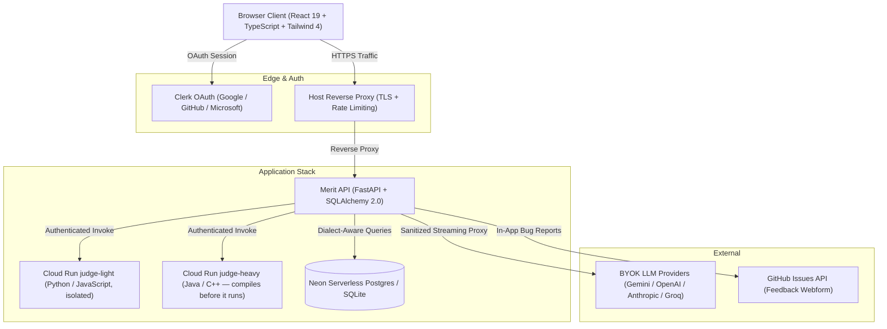

# MERIT — Placement-Grade DSA & Technical Assessment Workbench

> **"Step through the execution, not the explanation. Make the merit list."**

[](https://merit.nullbit.in)
[]()
[]()
[]()
[](LICENSE)

MERIT is an end-to-end technical assessment and Data Structures & Algorithms learning platform tailored for Indian engineering campus placements (TCS NQT Ninja/Prime, Infosys SP/DSE, Cognizant, and product-based hiring drives).

It bridges the gap between passive tutorial consumption and real campus test execution by pairing **frame-by-frame algorithm visualizers** with a **sandboxed code judge**, **tab-switch proctored mock exams**, a **live-judged AI mock-interview portal**, and a **privacy-first BYOK AI tutor**.

---

## System Architecture



---

## Key Features

### 1. Interactive Algorithm Visualizers (17 Engines)
* **Frame-by-frame state execution**: Step forward and backward with custom scrubbing speeds (0.25× to 2×).
* **Synchronized pseudocode**: Visual memory pointers and stack frames sync with highlighted logic lines.
* **Supported engines** (17 across 15 component files in `apps/web/src/visualizers/`):
  * **Graph Traversal**: Visual BFS & DFS over customizable adjacency lists and connected components.
  * **Shortest Path & Connectivity**: Dijkstra / Bellman-Ford relaxation and Union-Find DSU with path compression.
  * **Dynamic Programming**: 2D DP table fill order with dependency highlighting.
  * **Recursion Trees**: Unrolling call stacks and return values for Fibonacci, Subsets, and Divide-and-Conquer.
  * **Linear & Trees**: Binary Search Tree (Insert/Delete/Balance), Min/Max Heaps, Linked Lists, Stack, Circular Queue, Dynamic Array, Hashing collisions, and Trie.
  * **Sliding Window & Two Pointers**: Expand/contract windows and converging pointer movement.
  * **Sorting & Searching**: Bubble, Selection, Insertion, Merge, Quick Sort, and Binary Search intervals.

### 2. Timed Mock Placement Exams (11)
* **Indian Campus Drive Simulation**: 11 timed exams, including a 3-hour full mock with aptitude, core CS, and hands-on DSA sections.
* **Weak-Topic Breakdown**: Post-exam scoring identifies weak areas and feeds a **Retry Wrong** drill.
* **Exam Proctoring Engine**:
  * Persistent countdown timer with server synchronization.
  * Fullscreen enforcement & **tab-switch auto-submit detection** to prevent malpractice.
  * HackerRank-style sidebar navigator with answered/flagged/visited question states.

### 3. AI Mock Interview Portal
* **Dedicated routes**: `/interview` for setup and `/interview/:sessionId` for the live loop.
* **Multi-Round Loops**: Easy, Medium, and Hard loops mixing project, system-design, and coding rounds.
* **Live-Judged Coding**: An embedded `CodeRunner` grades interview code through the same sandboxed judge as practice.
* **CV-Aware Setup**: Optional PDF résumé upload parsed in memory (`pypdf`, ≤ 2 MiB); nothing is written to disk.
* **Cross-Device Persistence**: Sessions, rounds, and final rubrics are stored in `interview_sessions` and resume across devices.
* **Structured Hiring Rubrics**: Final scoring across explicit dimensions with a hire verdict.

### 4. Curated Problem Bank & Practice Modules
* **274 Verified Problems**: Spanning 18 placement topics with 100% automated Acceptance Criteria (AC) verified against reference solutions, and typed starter code for all four judged languages (Python, JavaScript, Java, C++).
* **Company-Aware Practice**: Distinctive company tags plus company, difficulty, and status filters.
* **OA Scratchpad**: Custom-input runs for open-ended practice, with hidden-test inputs and expected outputs redacted.
* **Continuous Doubly-Linked Sequences**: Seamless "Next in Category" navigation ordered strictly by pedagogical difficulty (`Easy` $\rightarrow$ `Medium` $\rightarrow$ `Hard`).
* **574 Verified Multiple-Choice Questions**: High-yield conceptual quizzes with timed locks, detailed explanations, and anti-pattern analysis.

### 5. Four-Mode BYOK AI Tutor
* **Modes**: Socratic, Step Hint, Code Review, and Mock Interview.
* **Signed-In Only**: The tutor and interview surfaces require login; there is no anonymous BYOK path.
* **Bring Your Own Key**: Presets for OpenAI, Gemini (OpenAI-compatible) and Groq; any OpenAI-compatible endpoint works via a custom base URL.
* **Zero Server Storage**: The key is kept in `sessionStorage` (single-tab lifetime, never `localStorage`) and is sent ephemerally through the Merit tutor proxy to the chosen provider; the server does not persist it. Production blocks loopback provider URLs.
* **Chain-of-Thought Sanitization**: Backend and frontend filters strip internal reasoning tags (`<thought>`, `<think>`) to ensure clean, pedagogical hints without leaking solutions.

### 6. Placement Readiness & Spaced Revision
* **Onboarding Diagnostic**: A 12-question placement diagnostic seeds the learner's starting tier.
* **Readiness Score + Drive Countdown**: Per-pillar scoring (DSA, quizzes/CS, mock exams, consistency) against an upcoming drive date.
* **SM-2 Review Deck**: A dedicated `/review` queue schedules the next review after graded work; the interval grows (`1d` → `6d` → `interval × ease`) and lapses reset it.
* **Per-User Schedule**: `revision_items` is scoped to the signed-in user and keyed on `(user, item_type, item_id)`.

### 7. In-App Bug & Test Case Feedback Webform
* Self-hosted dialog accessible across the application.
* Automatically captures problem context, page route, and error details, filing tracked issues directly into the public GitHub issue tracker via the GitHub REST API.
* An optional contact email is stored privately in the database only and is never published to the public issue.

---

## Engineered for Low-Cost Infrastructure

Merit is intentionally architected to operate **free of cloud compute costs**: the web and API tiers run on a single Oracle Cloud Free Tier AMD instance (1 vCPU / 1GB RAM) without triggering Linux OOM crashes, and code execution is offloaded to Cloud Run's always-free tier with `min-instances=0`, so an idle judge costs nothing.

| Container | Memory Limit | Memory Reservation | Purpose |
| :--- | :---: | :---: | :--- |
| **merit-api** | `350MB` | `200MB` | FastAPI uvicorn worker, SQLAlchemy ORM, and rate-limiting |
| **merit-web** | `64MB` | `32MB` | Production Nginx serving gzip-compressed single-page app |
| **Cloud Run judge-light** | — | — | Sandboxed Python / JavaScript execution, off-host in its own container |
| **Cloud Run judge-heavy** | — | — | Adds JDK and g++, so Java and C++ compile before they run |
| **OS & Buffer** | `~610MB` | — | Kernel headroom, swap cache, host TLS terminator, other host apps |

* **Total Memory Budget**: Stack caps itself at **414MB**, leaving ample headroom on a 1GB host.
* **Dialect-Aware Persistence**: Zero-configuration SQLite for local offline development; automatic dialect branching for Neon Serverless PostgreSQL with atomic upserts in production.
* **Security Hardening**: Enforcing `Content-Security-Policy` in `apps/web/nginx.conf`, global `BodyLimitMiddleware`, rate limits on judge and interview sessions, production startup refusal when `JUDGE_URL` is unset, `no-new-privileges:true` in `docker-compose.yml`, and BYOK tutor/interview locked behind login.

---

## Monorepo Layout

```text
.
├── apps/
│   ├── api/                 # FastAPI backend
│   │   ├── app/
│   │   │   ├── models/      # SQLAlchemy ORM models
│   │   │   ├── routers/     # Auth, Judge, Quizzes, Tutor, Interview, Revision, Feedback, Progress
│   │   │   ├── schemas/     # Pydantic validation schemas
│   │   │   └── seed.py      # Problem and question seed loaders
│   │   └── tests/           # 293 Pytest unit and integration tests
│   └── web/                 # React 19 single-page application
│       ├── src/
│       │   ├── components/  # Modals, Navbars, CodeRunner, QuizEngine, Tutor, Interview
│       │   ├── pages/       # Problems, Exams, Dashboard, Profile, Landing, Interview, Review
│       │   ├── visualizers/ # 17 interactive algorithm engines (15 component files)
│       │   └── store/       # Auth & Progress state contexts
│       └── tests/           # 397 Vitest component tests
├── content/
│   ├── problems/            # 274 verified problem JSON specifications
│   ├── questions/           # 574 verified multiple-choice items (772 files, 198 drafts quarantined)
│   ├── generators/          # Problem Authoring Framework (PAF) & TS sync scripts
│   └── validators/          # Automated content & reference solution AC gates
├── docker-compose.yml       # Production multi-container composition
```

---

## Quickstart (Local Development)

### Prerequisites
* **Node.js**: v20+
* **Python**: 3.12+
* **Docker & Docker Compose** (optional, for full sandboxed judge)

### 1. Clone the Repository
```bash
git clone https://git.nullbit.in/abhi/Algovista.git
cd Algovista
```

### 2. Backend Setup
```bash
cd apps/api
python3 -m venv .venv
source .venv/bin/activate
pip install -e .

# Apply migrations, then seed verified content
alembic upgrade head
python -m app.seed

# Start API server
uvicorn app.main:app --reload --port 8000
```

### 3. Frontend Setup
```bash
cd apps/web
npm install
npm run dev
```
Open [http://localhost:5173](http://localhost:5173) in your browser.

---

## Running Test Suites

### Backend Unit & Integration Tests (293 tests)
```bash
cd apps/api
.venv/bin/python -m pytest -q --no-header
```

### Frontend Component & Route Tests (397 tests across 55 files)
```bash
cd apps/web
npx vitest run
```

### Problem & Question Content Verification Suite
```bash
apps/api/.venv/bin/python content/validators/run_all.py
```

---

## Contributing & Bug Reports

Found an incorrect test case, edge case bug, or explanation typo?
* Use the in-app **Report Bug / Feedback** button in the footer or navbar.
* Or open an issue directly in the [GitHub Issue Tracker](https://github.com/abhigyan-chatterjee/merit/issues).

---

## License

This project is licensed under the [MIT License](LICENSE) — Copyright (c) 2026 Abhigyan Chatterjee.
